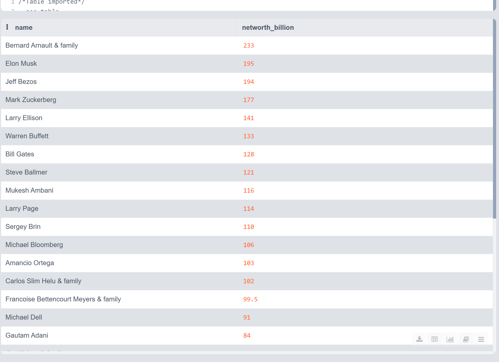
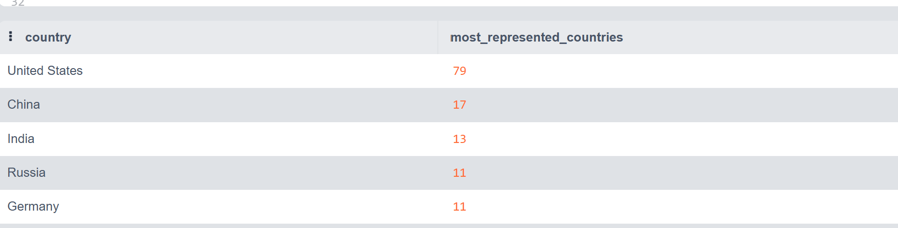
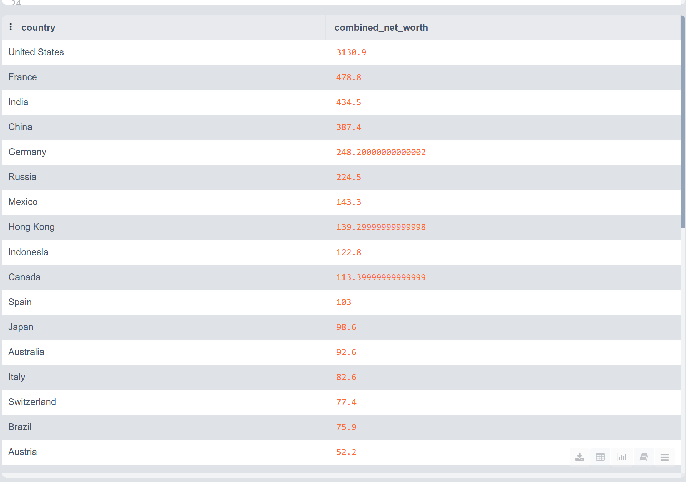
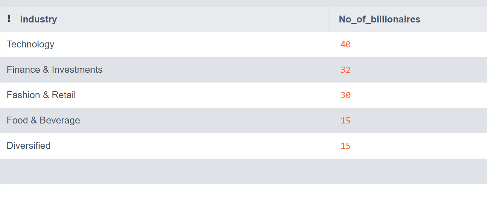
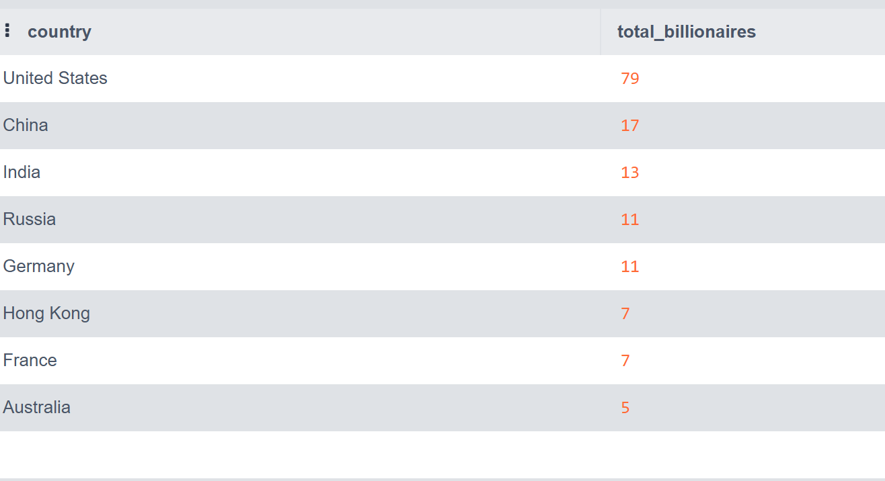
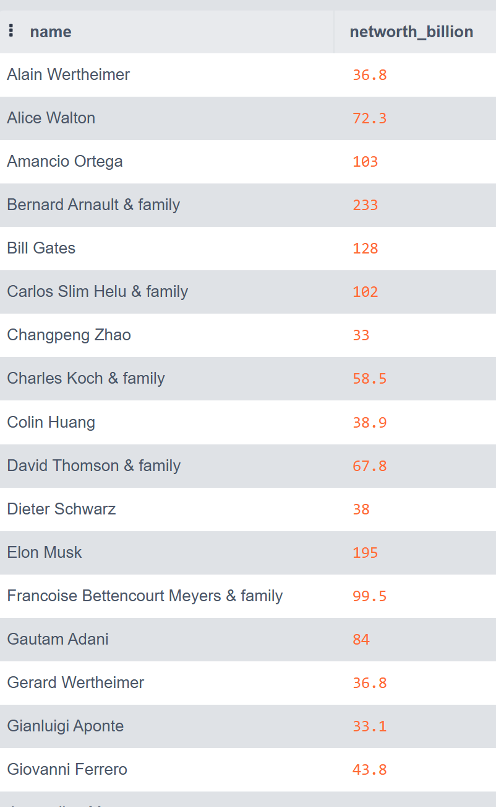
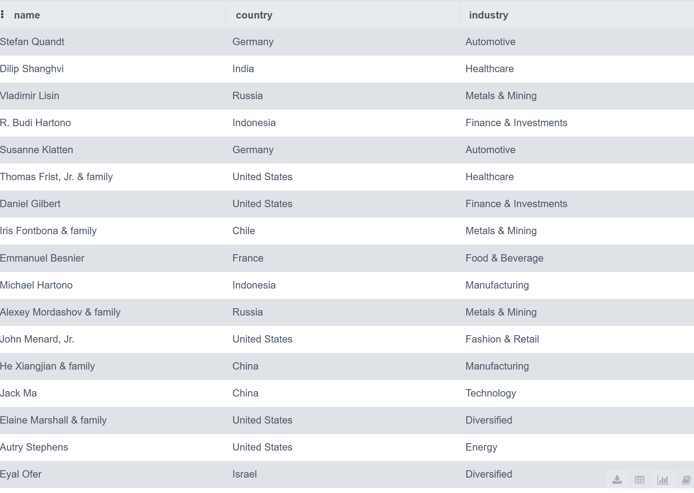
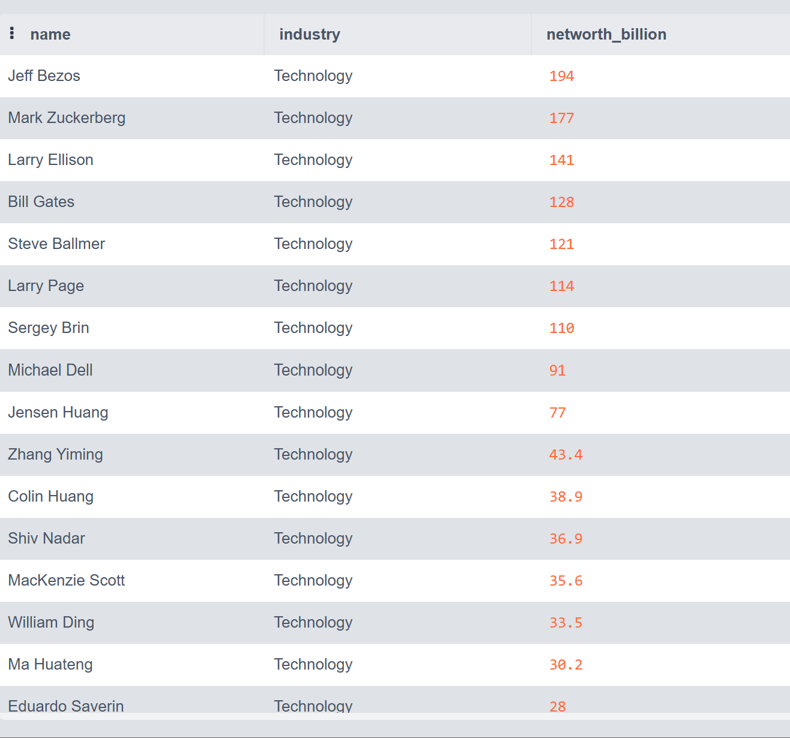
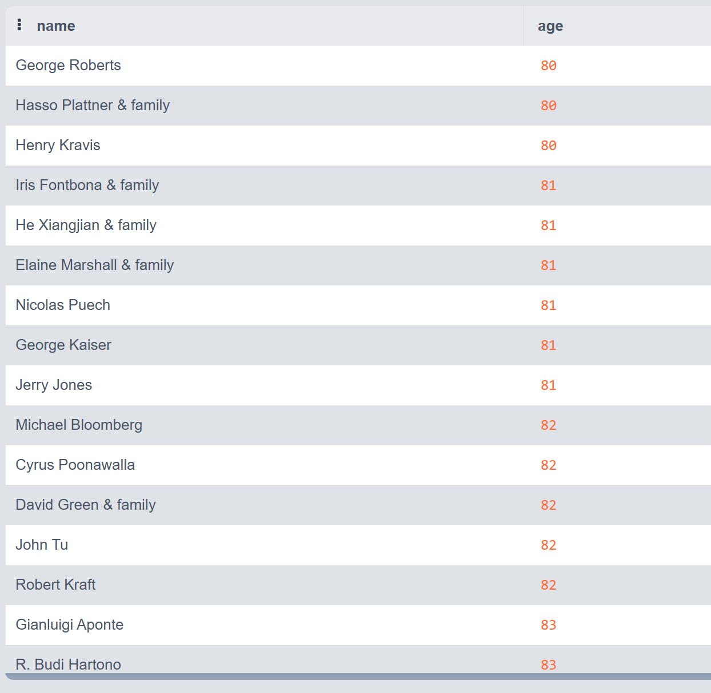

# Top200_Richest_Analysis_SQL
SQL analysis of the Top 200 Richest People in the World using SQLite.
## ABOUT THE CASE STUDY
This project analyses the Top 200 Richest People in the World dataset
using SQL. Acting as a data analyst, I explored the data provided to find out
who the richest billionaires are, which countries and industries are
most represented, how wealth is spread across them, and how age
relates to net worth. This analysis uses SQL concepts such as
SELECT, WHERE, ORDER BY, aggregate functions, GROUP BY, HAVING and
subqueries, and was done on SQLite Online.

## DATASET
The dataset contains one table, Top200RichestPersonintheWorld,
with 200 records. The columns are:
- serial_number: unique number for each row
- rank: the person's position on the richest list
- name: full name of the billionaire
- age: age of the billionaire
- country: country the billionaire is from
- networth_billion: net worth in billions of US dollars
- industry: industry the wealth comes from
## QUESTIONS AND OUTPUTS/ANSWERS TO EACH QUESTION

## QUESTIONS
1. Retrieve the 20 richest billionaires. 
2. Identify the five youngest billionaires. 
3. Calculate the average age and average net worth. 
4. Identify the five most represented countries. 
5. Calculate the combined net worth of billionaires from each country. 
6. Identify the five industries with the highest number of billionaires. 
7. Find countries with at least five billionaires. 
8. Calculate the total wealth of billionaires younger than 50. 
9. Identify billionaires whose net worth exceeds the overall average net worth. 
10. Identify the industry with the highest average net worth. 
    
### A. Basic SELECT, WHERE and ORDER BY
11. Show only the name, country and industry of all billionaires. 
12. List all billionaires from Nigeria. If there are none, show those from India. 
12b. 
14. Show billionaires in the Technology industry, ordered by net worth from highest to lowest. 
15. List billionaires aged 80 or older, with their names and ages. 
16. Show billionaires whose names start with the letter M.

### B. Aggregates
6. Count how many billionaires are in the table.
7. Find the oldest and youngest ages.
8. Find the highest net worth among billionaires from the United States.
9. Calculate the total net worth of all billionaires in the Technology industry.

### C. GROUP BY and HAVING
10. Count the billionaires in each industry, ordered from most to least.
11. Find the average age of billionaires in each country.
12. Show industries whose combined net worth is above 300 billion.

### D. Harder (subqueries and combined conditions)
13. Find billionaires who are older than the average age.
14. Show billionaires from the United States who are in Technology and worth more than 50 billion.
15. Find the country with the highest average net worth, but only among countries with at least 3 billionaires.
